<div align="center">


# Aurelia Finance Lab

**Learn hotel commercial finance by running one.**

An offline Windows desktop simulator where you take the finance seat at *The Aurelia Grand*, a fictional
150-room luxury hotel, and practise revenue management, FP&A, forecasting, three-statement modelling,
investment appraisal, Excel and executive decision-making on a live, fully integrated model.

[](https://github.com/mutima89/TheFinLap/releases/latest)
[](https://github.com/mutima89/TheFinLap/actions/workflows/release.yml)
[](https://github.com/mutima89/TheFinLap/actions/workflows/tests.yml)


[**Download for Windows**](#-download-and-run) · [Screenshots](#-a-tour) · [Features](#-what-you-can-do) ·
[Build from source](#-run-or-build-from-source) · [Docs](#-documentation)

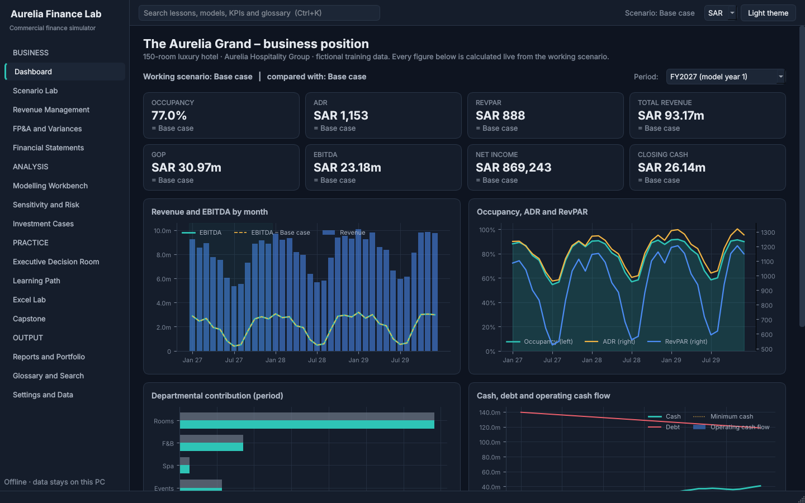

</div>

> [!NOTE]
> Every number in the app is generated by the simulator for a **fictional** hotel. Nothing here is real hotel
> data or an industry benchmark. Scores and competency levels are practice feedback, not an accredited
> qualification or a guarantee of employment.

## ✨ Why it is different

* **One engine, everything connected.** A calculation graph of 13 nodes and 97 line items links daily rooms
  demand to departmental profit, EBITDA, the balance sheet and cash over 36 months. Change a room rate and you
  see the effect flow through to closing cash. Fourteen integrity checks run on every recalculation.
* **Judgement, not just arithmetic.** The Executive Decision Room gives you nine realistic management situations,
  asks you to quantify the options and defend a recommendation, and grades reasoning, evidence and risk as well
  as the answer.
* **Honest analysis.** Variance explanations separate what the data measures from causes you still need to
  confirm. The app never invents a cause where the data only shows a correlation.
* **Learn by doing.** A nine-stage path with 26 topics, worked examples computed by the real engine, exercises,
  a rule-based coach, a graded Excel Lab and a ten-step capstone.
* **Private by design.** Fully offline. No account, no analytics, no network calls; your work lives in a local
  SQLite file you can back up, restore or reset.

## 📥 Download and run

1. Open the [**latest release**](https://github.com/mutima89/TheFinLap/releases/latest) and download
   `Aurelia_Finance_Lab-<version>-win64.zip`.
2. Right-click the zip, choose **Extract All…**, and open the extracted `Aurelia_Finance_Lab` folder.
3. Double-click **`Aurelia_Finance_Lab.exe`**. No installer and no Python needed.

The release `.exe` is produced by the [Release workflow](.github/workflows/release.yml) on a GitHub-hosted
Windows runner. The workflow runs the full test suite on Windows, builds the app with PyInstaller, runs the built
executable's own self-test, and only publishes the zip if every step passes. Each release lists SHA-256 checksums
and the build and self-test reports.

> [!TIP]
> The executable is not code-signed, so Windows SmartScreen may say *"Windows protected your PC"* the first time.
> Choose **More info → Run anyway**. You can check the download against `SHA256SUMS.txt` with
> `Get-FileHash Aurelia_Finance_Lab.exe` in PowerShell.

Requirements: Windows 10 or 11, 64-bit. To check an installation at any time, run
`Aurelia_Finance_Lab.exe --selftest` (see [command-line options](#command-line-options)).

## 🧭 A tour

| | |
|---|---|
| 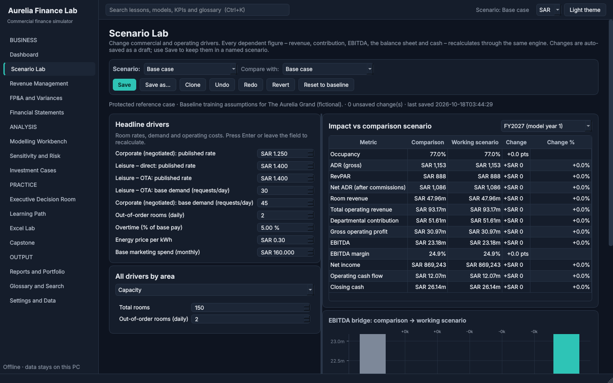<br>**Scenario Lab.** 91 validated drivers, compare against any scenario, EBITDA bridge, undo/redo and an auto-saved draft. | 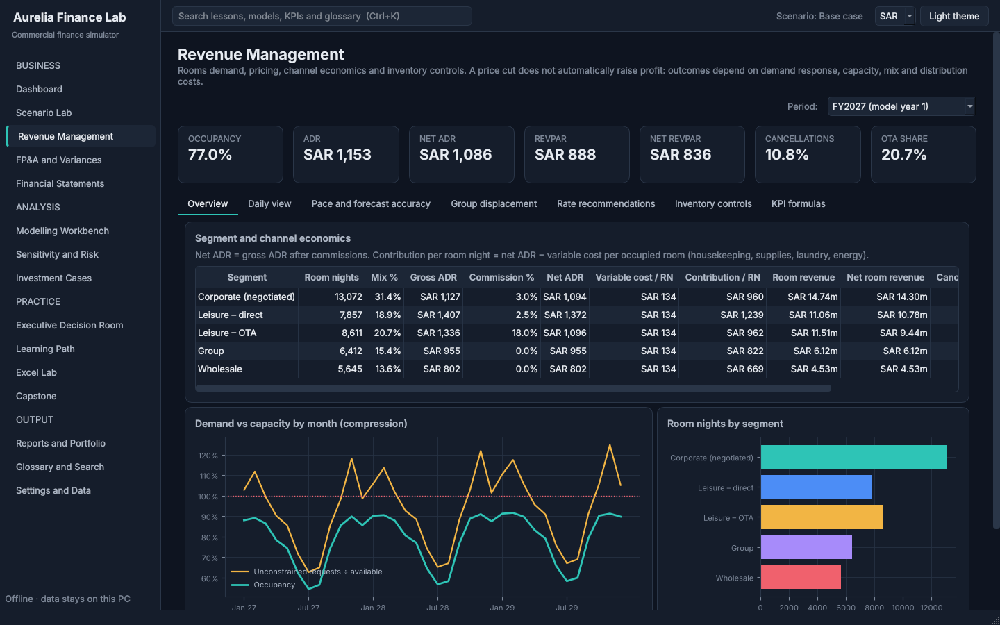<br>**Revenue Management.** Segment and channel economics, pace, displacement, MLOS, overbooking and forecast accuracy. |
| 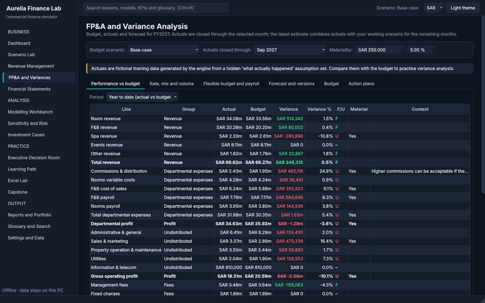<br>**FP&A and Variances.** Budget vs actual vs latest estimate, price/volume/mix, flexible budget and evidence-backed explanations. | 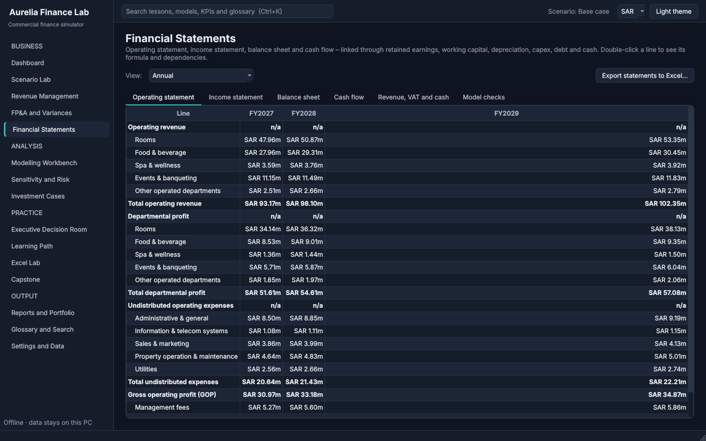<br>**Financial Statements.** USALI operating statement, income statement, balance sheet, cash flow and integrity checks. |
| 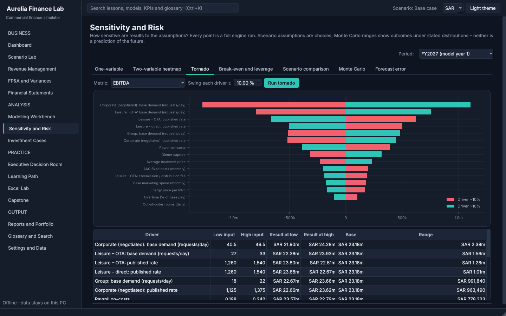<br>**Sensitivity and Risk.** One- and two-way sensitivity, tornado, break-even and Monte Carlo with a visible seed. | 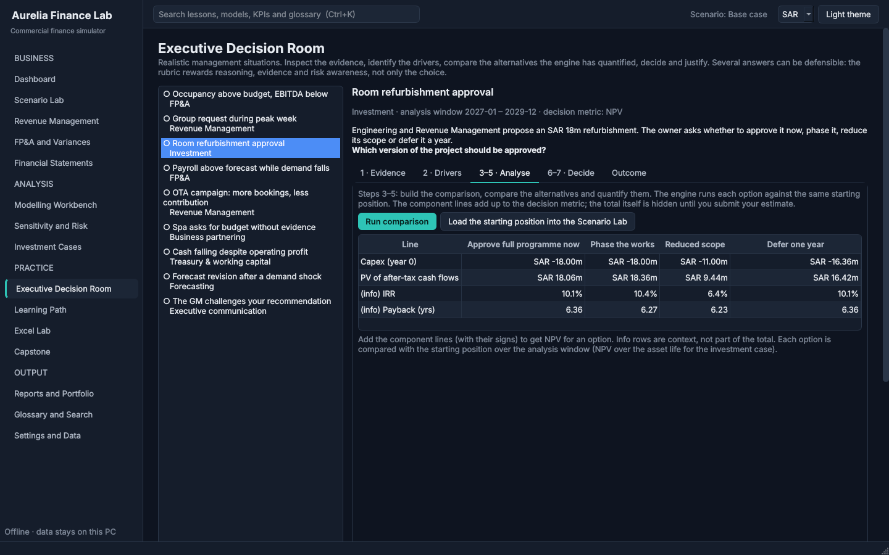<br>**Executive Decision Room.** Quantify the alternatives, decide, justify and see the outcome. |
| 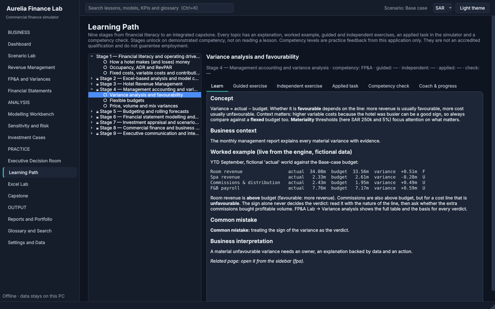<br>**Learning Path.** Nine stages and 26 topics that unlock as you demonstrate competency. | 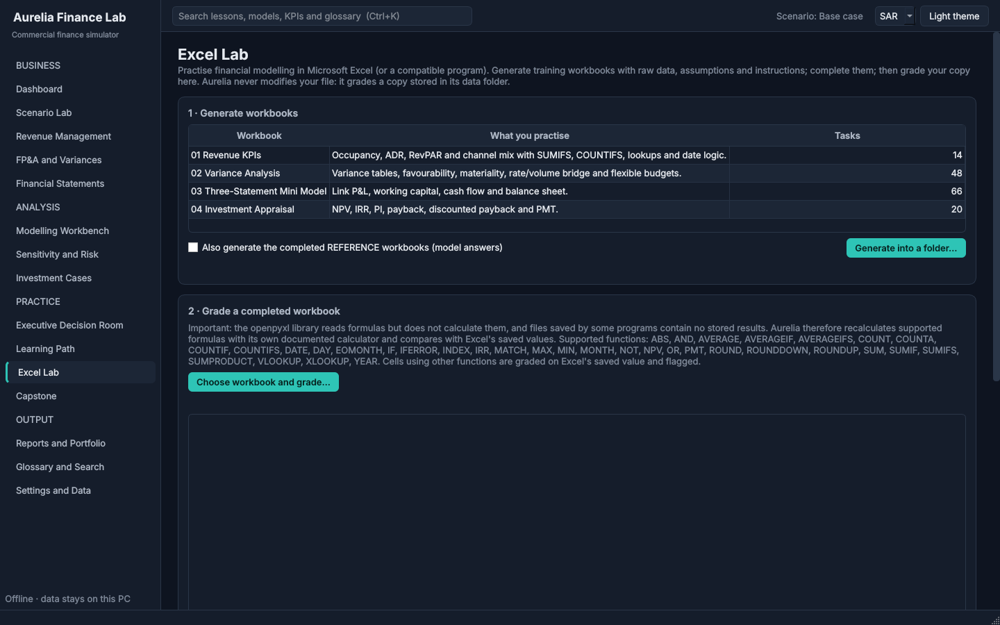<br>**Excel Lab.** Generate practice workbooks and have a copy of your finished file graded. |
| 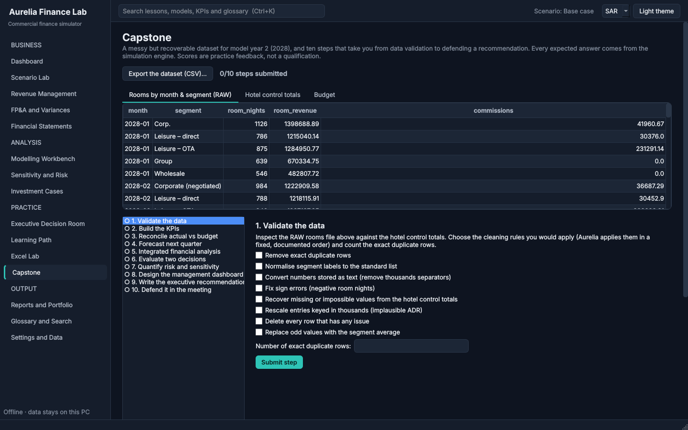<br>**Capstone.** Clean a messy dataset and defend your analysis across ten scored steps. | 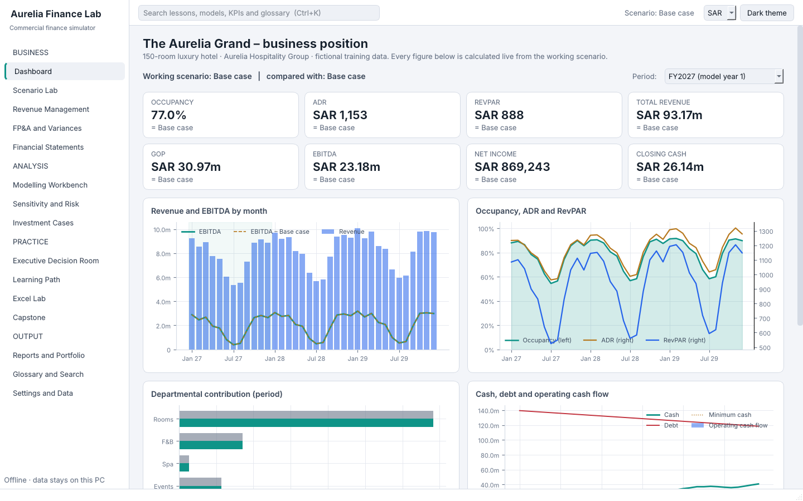<br>**Light and dark themes**, SAR or USD display, global search (Ctrl+K). |

## 🧰 What you can do

| Area | Highlights |
|---|---|
| Dashboard | Current position, budget and forecast status, next learning objective, open decisions, competencies |
| Scenario Lab | 91 drivers, Base/Upside/Downside reference cases, save, clone, checkpoints, undo/redo, audit trail |
| Revenue Management | Segment and channel economics, pace, displacement, rate search, MLOS, overbooking, forecast accuracy |
| FP&A and Variances | F/U classification, materiality, price/volume/mix, flexible budget, action plans, forecast versions |
| Financial Statements | Operating statement, P&L, balance sheet, cash flow, revenue-to-cash bridge, 14 integrity checks |
| Modelling Workbench | Models A–H, dependency viewer, safe custom formulas, model warnings |
| Sensitivity and Risk | One-way, two-way, tornado, break-even, scenarios, Monte Carlo, forecast error |
| Investment Cases | Six business cases with NPV, IRR, MIRR, payback, discounted payback, PI and sensitivities |
| Executive Decision Room | Nine cases in seven steps, five-dimension rubric, outcome reveal and next investigations |
| Learning Path | Explanations, engine-backed worked examples, guided and independent exercises, applied tasks, checks |
| Excel Lab | Four generated workbooks with reference answers; grades a **copy** of your file, never the original |
| Capstone | Messy but recoverable dataset, ten scored steps, meeting defence |
| Reports and Portfolio | Seven-section management report (HTML/PDF), Excel exports, scenario comparison, portfolio (HTML/PDF/JSON) |
| Settings and Data | Theme, currency, storage disclosure, backup/restore, scenario import/export, integrity check, reset |

## 🛠 Run or build from source

You need 64-bit **Python 3.12**.

```powershell
git clone https://github.com/mutima89/TheFinLap.git
cd TheFinLap
python -m venv .venv
.venv\Scripts\activate            # Linux/macOS: source .venv/bin/activate
pip install -r requirements.txt
python run_aurelia.py
```

**Build the Windows executable yourself** with one command from the project folder:

```bat
build_windows.bat
```

It creates `.venv-build`, installs the pinned `requirements-lock.txt`, runs the tests, builds with
`packaging\aurelia.spec`, runs the built `.exe` self-test, and writes `dist\Aurelia_Finance_Lab-<version>-win64.zip`
with SHA-256 checksums. It stops at the first failure. Details are in [docs/BUILD_WINDOWS.md](docs/BUILD_WINDOWS.md).

**Tests:**

```bash
pip install -r requirements-dev.txt
QT_QPA_PLATFORM=offscreen pytest      # Windows PowerShell: $env:QT_QPA_PLATFORM="offscreen"; pytest
```

### Command-line options

These work the same for `python run_aurelia.py` and the `.exe`:

```
--selftest [--report FILE] [--quiet]   run the built-in self-test (14 checks) and write a diagnostic report
--generate-workbooks DIR               write the four Excel practice workbooks to DIR
--data-dir DIR                         use a specific data folder (portable mode)
--smoke-ui                             open every page off-screen and exit
--version                              print the version
```

## 🔒 Privacy

Everything stays on your computer. The app does not transmit data, collect analytics, require an account, or
store credentials or API keys. Your data lives in `%APPDATA%\AureliaFinanceLab\` (shown in Settings), never in
the program folder. The built-in self-test checks that no application module imports networking code.

## 📚 Documentation

| Document | For |
|---|---|
| [User guide](docs/USER_GUIDE.md) | How to use every part of the app |
| [Troubleshooting](docs/TROUBLESHOOTING.md) | Problems and fixes |
| [Model reference](docs/MODEL_REFERENCE.md) | The hotel, the engine, models A–H, cases and the learning path |
| [Calculations and assumptions](docs/CALCULATIONS_AND_ASSUMPTIONS.md) | Conventions, VAT, tax, financing, grading rules |
| [Generated calculation reference](docs/CALCULATION_REFERENCE_GENERATED.md) | Every line item, driver, KPI and check, generated from the code |
| [Glossary](docs/GLOSSARY.md) | Terms and shortcuts |
| [Architecture](docs/ARCHITECTURE.md) | Structure, data flow, storage and testing |
| [Known limitations](docs/KNOWN_LIMITATIONS.md) | What the simulator does not do |
| [Release notes](docs/RELEASE_NOTES.md) | Version history |
| [Windows build steps](docs/BUILD_WINDOWS.md) | Producing the `.exe` yourself |
| [Build and verification report](docs/BUILD_AND_VERIFICATION_REPORT.md) | What was tested, where, and the results |

## 🗂 Project layout

```
aurelia/            application package
  model/            assumptions, calculation graph engine, scenarios
  analysis/         statements, RM, FP&A, sensitivity, investment, decisions, capstone
  excel/            formula calculator, workbook generator, grader
  learning/         content, competency rules, coach, glossary and search
  reports/          management report, Excel exports, portfolio
  persistence/      SQLite storage, backup and restore
  ui/               PySide6 main window, pages, widgets, themes, onboarding
  selftest.py       --selftest checks and diagnostic report
tests/              pytest suite (166 tests: engine, finance, analysis, Excel, learning, UI)
packaging/          PyInstaller spec and Windows version resource
tools/              documentation generator
sample_data/        fictional sample workbooks, capstone CSVs and a statement export
.github/workflows/  tests on every push; Windows build and release on version tags
```

## ⚖️ Disclaimer

Aurelia Finance Lab is an educational simulator. *The Aurelia Grand*, *Aurelia Oasis* and *Aurelia Hospitality
Group* are fictional, and all figures are simulated. Nothing in the app is financial, investment or career
advice, and practice scores are not a professional qualification.
